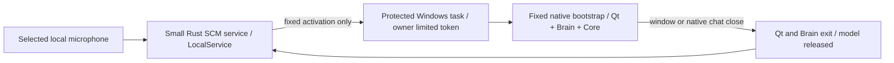

# Windows wake service — implementation and acceptance, 2026-10-19

Status: native SCM/installation/lifecycle implemented in this repository. A real user wake
succeeded after replacing the initial detector. **General acoustic acceptance remains OPEN**:
the pretrained model can wake on the name alone and missed a Turkish synthetic fixture.
The prior planning-only restriction was superseded by the user's explicit request to push
first and then implement a service included in the same JARVIS installation.

## Same product, independent idle process

`services/wake` is a Cargo workspace crate, not an unrelated application or a dependency of
Core. Root `install.cmd` prepares the existing JARVIS command and its native Windows service
together. The service needs its own Windows executable/host internally, but has no visible
application window or Qt/Python/model resident. Windows Services owns its lifetime.



Idle capture uses a checksum-pinned official LiteRT2.3.0 CPU DLL and openWakeWord v0.5.1
TFLite mel/embedding/hey_jarvis graphs. Rust calls the stable C ABI directly. Setup extracts
only `libLiteRt.dll` from the official pinned wheel, without installing/importing Python,
GPU accelerators or vendor plugins. No ONNX parser/runtime, full ASR, CUDA, GPU allocation,
inference server or runtime download belongs to this service. Audio remains in bounded memory.
Only a Boolean wake, counters, signal level and model score are exposed; no transcript/PCM log.
Pretrained weights are unchanged and the published 0.5 threshold was not lowered to hide misses.

## Privilege and lifecycle boundaries

SCM `JarvisWake` runs as **LocalService**, Automatic (Delayed Start), from protected
`%ProgramFiles%\JARVIS\Wake`. Only Administrators/SYSTEM write its executable/config/runtime.
`%ProgramData%\JARVIS\Wake\status.json` is the bounded writable status, not trusted instructions.
No LocalSystem execution of user-editable repository code is involved.

The only launch target is protected task `\JARVIS\Launch`, registered for the installed
owner SID with InteractiveToken/Limited, no password. LocalService gets read/execute rights
only; it cannot edit the action. That action invokes the same protected native executable's
`desktop` mode, which runs the fixed existing bootstrap as the normal user. Agent/model text
cannot choose paths, commands, task names or executable identities. Subsequent AI effects
still use JarvisCoreClient -> Named Pipe -> Rust registry -> validation -> policy -> executor.

The active unlocked console account must match the installed owner before capture/activation.
The microphone is dropped BEFORE task activation and remains closed while the task runs.
Repeated requests are ignored by the running task; voice activations also have a 15s cooldown.
Discarded detections are consumed, never replayed after cooldown. Fatal capture errors drop
the stream and retry after a bounded delay; recoverable xruns/discontinuities reset audio history.
Pause/Resume/Stop work through SCM. The owner can control/query the service but cannot reconfigure
its executable. Native status includes the actual selected microphone and non-content metrics.

`jarvis -Desktop` uses the same fixed service/task. A stopped listener still permits manual
desktop opening without restarting background capture. Normal close exits Qt/Brain; the
bootstrap stops only a Core it started itself. A kill-on-close Windows job cleans the task's
new descendants if the parent is terminated. Existing shared Core clients are preserved.
Per the latest explicit user preference, desktop opening starts Turkish recognition/voice and
Auto conversation. Qt keeps its microphone closed during the model's estimated activation
countdown, waits for actual model readiness and completed welcome speech, then captures on
Windows' default microphone. The service still only requests app opening;
normal speech controls and Core policy own subsequent capture. Escape stops Auto conversation.

## Setup and controls

Complete the existing Brain/Desktop dependencies and pinned local agent model first, then:

```powershell
.\install.cmd
.\install.cmd -SkipBuild -WakeMicrophone "Mikrofon (BSX USB Audio)"
.\install.cmd -SkipBuild -DefaultWakeMicrophone
.\install.cmd -RemoveWakeService
```

Setup provisions/builds as the regular user, then requests real Windows UAC for protected
copies, task and SCM registration. No persistent execution-policy setting is changed. The
bootstrap does not silently download a language model. This is the local developer installer,
not a self-contained MSI/distribution of all prerequisites. `-SkipWakeService` omits the service.
Removal retains personal tasks/notes, language models and the desktop; manual launch still works.
Moving the repository requires reinstalling its fixed launch binding.

The latest user preference supersedes the earlier BSX USB pin: follow Windows' default.
`-DefaultWakeMicrophone` explicitly clears a previous pin. The service checks default endpoint
identity once per second and drops old PCM/features before reopening. An optional explicit
fixed-device pin still reports errors instead of silently switching.
Windows Services or `Suspend-Service JarvisWake`, `Resume-Service JarvisWake`, `Stop-Service
JarvisWake` control capture. Read status with `Get-Content "$env:ProgramData\JARVIS\Wake\status.json"`.

## Evidence and limits

Checkpoint **b9ab758e15525a0b09afa3150d83701e86a6e8c7** was committed/pushed FIRST and remote
origin/main verified. It contains the previous organizer/true-close work, not this new service.
Before it: Brain/Qt546 passed/202 skipped; Rust110 passed/7 ignored. The service work is currently
uncommitted/unpushed; never infer publication from the checkpoint.

- Actual LocalService Session0 probe captured 300 callbacks/288000 samples in ~3.3s, 48kHz stereo
  AMD microphone. Temporary probe service was removed. No PCM saved.
- Initial PocketSphinx keyword detector: EN normal/slow synthetic successes; TR synthetic miss;
  five negatives rejected. Actual user's voice FAILED. Counts alone did not establish usability.
- Official native neural replacement: user confirmed real activation **worked**. The status
  snapshot had three accepted launches, which are not proof of three completed successful opens.
- Same eight synthetic fixtures through unchanged official LiteRT: EN normal/slow detected;
  four ordinary/near/greeting negatives rejected; name-only FALSE WAKE (~0.999); TR TTS MISS
  (~0.107). Diagnostic retains failure status; this is not overall acceptance.
- Pure-Rust tract experiment needed unsupported-operator/shape fixes and was rejected from the
  product. A phonetic-prefix experiment did not improve measured failures and was also removed.
  No custom graph reader, vendor patch, extra keyword engine or transcript rewrite remains.
- Fresh native unit5 passed; all-target Clippy, formatting, PowerShell parse and diagnostic Ruff
  passed. Installed BSX smoke passed pause/resume, fixed activation THROUGH LocalService, one
  task after three repeated requests, microphone handoff, actual Qt/Core-policy close and rearm.
- Stopped-listener manual opening and forced-parent termination passed: six owned processes
  gone, pre-existing Core preserved. The listener was restarted after this test.
- Final continuous idle window30.413s, BSX USB: private8.07MiB, working set19.16MiB,
  normalized CPU0.491% across16 logical processors. This is a short measured window,
  not proof of long-duration targets or false-wake rates. No wake occurred during that window.

Evidence: target/wake-service-final-smoke.log, wake-service-smoke.json,
wake-lifecycle-contract.{log,json}, wake-user-confirmed.json, wake-service-final-metrics.json,
wake-litert-evaluation.json. Original failed experiments are retained under target/wake-provider;
they are not active production dependencies. The user success preceded the explicit BSX device
change; the BSX software/stream/lifecycle test passed, but its voice accuracy needs normal use.

Not claimed: 8-hour false-wake rate, far-field/music/TV accuracy, sustained 10-minute CPU target,
post-reboot/unlock/sleep acceptance, 20-cycle GPU leak audit or Siri-level detection. Initial
host memory/CPU snapshots are short measurements only. Name-only false activation remains open.
CLI sessions/direct development Python windows do not participate in the desktop task's single
instance gate; pause the listener while using them. Core's desktop lease can take up to8s to
expire after a forced crash; immediate conversational-close attachment can be temporarily busy.
One console owner is supported; RDP/multiuser activation is not implemented.

The upstream pretrained model license is CC BY-NC-SA4.0, distinct from Apache2.0 code/runtime.
This personal local prototype is not a commercial redistribution approval. License texts and
attribution are included; runtime/model artifact hashes are in Rust and the setup manifest.

## Reproduce

```powershell
cargo test -p jarvis-wake-service --bin jarvis-wake-service --release --locked --target-dir target/wake-service -j 2
cargo clippy -p jarvis-wake-service --all-targets --target-dir target/wake-service -j 2 -- -D warnings
cargo fmt --all --check
.\scripts\tests\smoke_wake_service.ps1
.\scripts\tests\smoke_wake_lifecycle.ps1
cargo run -p jarvis-wake-service --example evaluate_wake --release --target-dir target/wake-service
```

Real SCM tests are opt-in, operate only this product's task/service and must run in the real
Windows owner session. File evaluation requires the original local synthetic WAVs under
target/wake-fixtures and exits nonzero for unresolved cases. No result is dispatched to Brain.

Primary references: [Microsoft service processes](https://learn.microsoft.com/en-us/windows/win32/services/service-programs),
[Session0/UI](https://learn.microsoft.com/en-us/windows/desktop/services/interactive-services),
[task security](https://learn.microsoft.com/lb-lu/windows/win32/taskschd/security-contexts-for-running-tasks),
[openWakeWord](https://github.com/dscripka/openWakeWord),
[official LiteRT](https://github.com/google-ai-edge/LiteRT).
